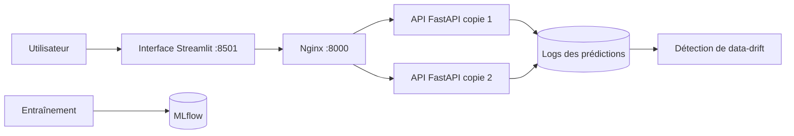

# Diagnostic des maladies des plantes — projet MLOps

Mise en production d'un modèle de classification d'images qui reconnaît **38 couples plante / maladie** à partir d'une photo de feuille.

Projet MLOps, Efrei — Chaima et Ghaith Ben Hammed.

## Le modèle

| Élément | Choix |
|---|---|
| Tâche | Classification d'images (38 classes) |
| Architecture | MobileNetV3-Small (réseau convolutif) |
| Méthode | Transfer learning : modèle pré-entraîné sur ImageNet, dernière couche réentraînée |
| Données | PlantVillage, 200 images par classe, découpage 80 % / 20 % |
| Précision en validation | **93,6 %** (1 511 images) |

MobileNetV3-Small est léger (6 Mo) et rapide sur processeur : il tourne sur une petite VM sans carte graphique.

## Architecture



Tous les services tournent dans des conteneurs Docker, sur une VM AWS EC2 (t3.small, Ubuntu 24.04).

## Lancer le projet

1. Entraîner le modèle :

```bash
python3 -m venv .venv && source .venv/bin/activate
pip install -r training/requirements.txt
python training/train.py
python training/register.py
python monitoring/reference.py
```

2. Créer un fichier `.env` (non versionné) contenant `API_KEYS=utilisateur1:cle1,utilisateur2:cle2`.

3. Lancer tous les services en une commande :

```bash
docker compose up -d --build
```

L'API est sur http://localhost:8000 (documentation : `/docs`) et l'interface sur http://localhost:8501.

4. Déployer sur la VM :

```bash
./deploy.sh
```

## Routes de l'API

Toutes les routes, sauf `/health`, demandent une clé dans le header `X-API-Key`.

| Route | Rôle |
|---|---|
| `GET /health` | État du service et copie de l'API qui a répondu |
| `POST /predict` | Envoie une image, renvoie les 3 diagnostics les plus probables |
| `GET /usage` | Nombre de prédictions de l'utilisateur |
| `GET /drift` | Compare les images reçues aux images d'entraînement |

## Niveaux réalisés

| Niveau | Réalisation |
|---|---|
| 0 | Tout se lance avec `docker compose up` |
| 1 | VM AWS créée à la main, déploiement par `./deploy.sh`, clé d'API dans le header, suivi de l'usage, test de charge Locust |
| 2 | Interface Streamlit, MLflow (suivi et registre de modèles), détection de data-drift |
| 3 | Quantization (FP32 / INT8 / FP16), scaling horizontal (2 copies de l'API derrière Nginx) |

## Résultats

### Tests de charge (Locust, 1 minute)

| Configuration | Utilisateurs | Échecs | Médiane | 95e centile | Débit |
|---|---|---|---|---|---|
| VM, 1 copie | 20 | 0 | 58 ms | 100 ms | 14,6 req/s |
| VM, 1 copie | 60 | 0 | 74 ms | 160 ms | 43,1 req/s |
| VM, 2 copies + Nginx | 60 | 12 (0,47 %) | 71 ms | **120 ms** | 43,1 req/s |

Le scaling horizontal réduit le 95e centile de 25 %. Les 12 erreurs ont toutes eu lieu dans la première seconde du test, lancé juste après le déploiement, pendant que les deux copies chargeaient encore leur modèle.

### Data-drift

| Mesure | Référence | Photos normales | Photos assombries |
|---|---|---|---|
| Luminosité | 0,459 | 0,457 | 0,163 |
| Confiance du modèle | 97,5 % | 94,6 % | **77,8 %** |
| Dérive détectée | | non | **oui** |

Sur des photos plus sombres, la confiance du modèle chute de 97,5 % à 77,8 % sans aucun message d'erreur : la détection de data-drift permet de le repérer.

### Quantization

| Version | Taille | Latence | Précision |
|---|---|---|---|
| FP32 (d'origine) | 6,36 Mo | 41,7 ms | 93,6 % |
| **INT8 dynamique** | **4,47 Mo** | 42,5 ms | **93,6 %** |
| FP16 | 3,22 Mo | 72,6 ms | 93,6 % |

INT8 réduit la taille de 30 % sans perte de précision ni de vitesse : c'est le meilleur compromis sur processeur.

## Limites

- Les photos d'entraînement sont prises en laboratoire : le modèle sera moins fiable sur des photos de terrain.
- Le modèle INT8 a été évalué mais n'est pas encore déployé.
- La VM a été créée à la main (Terraform permettrait de l'automatiser).